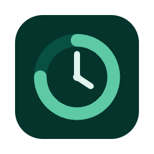
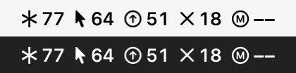
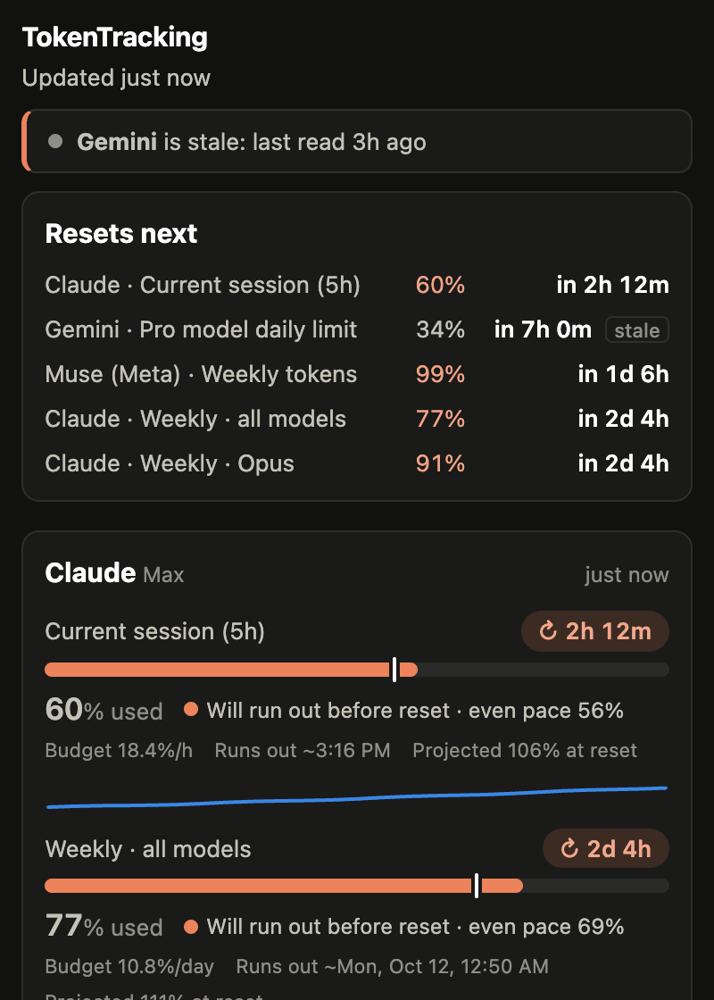
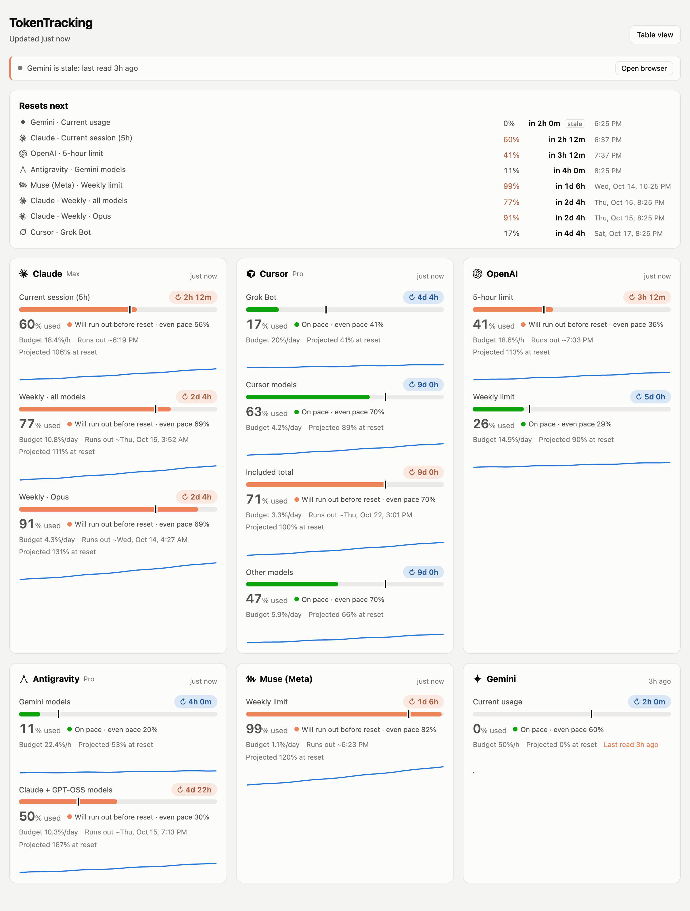
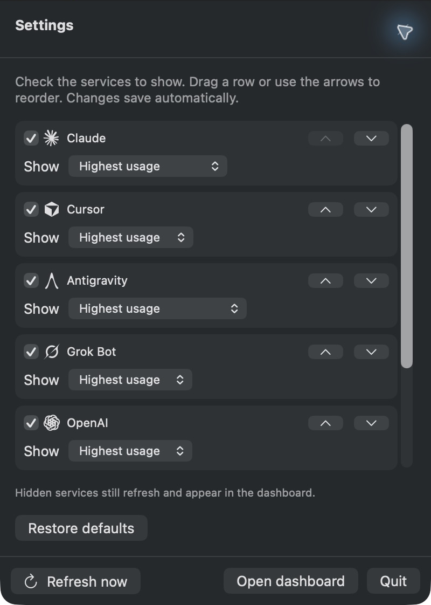

<p align="center"></p>

# TokenTracking

One place to see how close you are to the usage limits of your AI subscriptions, and how to pace yourself until they reset. It lives in your macOS menu bar.

Supported: **Claude**, **Cursor** (including **Grok Bot**'s weekly limit), **OpenAI (ChatGPT)**, **Gemini (app)**, **Muse (Meta)**, and **Antigravity** (per quota pool, while the app is running). OpenAI signed-in reads have been verified; a possible duplicate usage row is still under review. See [docs/PROVIDERS.md](docs/PROVIDERS.md).

It's **local-first**:
- **Refresh:** every 15 minutes a headless Chrome (no window, no Dock icon) uses its own logged-in profile to read each service's usage, then quits. Chrome exits after each run.
- **Storage:** a small local service stores the history and works out pacing.
- **Antigravity:** read from the desktop app's own local server while it's running (no browser; see [SECURITY](docs/SECURITY.md)).
- **Display:** a menu bar app shows the result.

No API keys, no TokenTracking account, no telemetry, no browser extension. Your existing provider accounts are used only inside the dedicated browser profile.

<p align="center">
  
</p>

<p align="center">
  
  &nbsp;
  
</p>

<sub>Screenshots show the current source build and use demo data (`npm run screenshots`; native captures use the generated demo-only preview app). Published preview downloads may lag the source; Settings customization will ship in the next packaged preview.</sub>

## Features

- **Every limit in one place.** Session (5h), daily, weekly and monthly meters per service, with time until reset.
- **Pacing.** Each meter shows:
  - the *even pace* marker (where you'd be if you spread usage evenly through the window)
  - your current burn rate and projected % at reset
  - when you'd run out at this rate
  - a budget (%/day, or %/hour when less than a day is left)
- **When it frees up.** Every meter has a countdown pill to its reset, and a "Resets next" list shows what frees up soonest across all services.
- **Status at a glance.** Shown as a colored dot plus a label: On pace, Ahead of pace, Will run out before reset, Limit reached.
- **History.** A sparkline per meter, with hover readouts, from every snapshot stored locally in SQLite.
- **Menu bar app:**
  - **Usage slots:** a brand icon and percentage per selected service; at the limit it shows a reset countdown (e.g. `↻2h`, `↻45m`) or `MAX`, and `??` means no reading or an unavailable selected meter.
  - **Native panel:** click for notices, upcoming resets and every meter, with Refresh now / Open dashboard / Quit.
  - **Settings:** the top-right gear becomes an X to return. Show/hide services (including Gemini), drag whole rows with live reordering, use accessible arrow buttons, and choose a specific meter or **Highest usage**. Preferences save locally; Restore defaults resets them. Hiding all services leaves a clickable app icon.
  - **Lifecycle:** the app starts and stops the local service it owns.
- **Also:** the full dashboard at http://127.0.0.1:7878 (card and table views, light and dark) and `npm run status` in the terminal.
- **Stale, login and error notices with an Open browser button.** Services whose data is stale (missed about 2 refreshes) or whose login expired are listed at the top with the reason. **Open browser** opens the TokenTracking browser on that service; quit it (⌘Q) when you're done and that service refreshes automatically.

## Download for Mac

[**Download for Mac — Apple Silicon**](https://github.com/mduppes/TokenTracking/releases/download/v0.6.0-preview.1/TokenTracking-0.6.0-preview.1-arm64.dmg) · [**Intel Mac**](https://github.com/mduppes/TokenTracking/releases/download/v0.6.0-preview.1/TokenTracking-0.6.0-preview.1-x64.dmg)

Requires **macOS 13+** and **Google Chrome**. Node and the local service are included; no terminal, Git or Xcode tools needed.

1. Download the DMG for your Mac (Apple menu → About This Mac shows **Chip** for Apple Silicon, **Processor** for Intel).
2. Open the DMG and drag **TokenTracking** to **Applications**. Launch it from Applications.
3. Click **Open browser** on each provider you use, log in, then quit the dedicated Chrome window with **Cmd+Q**. That provider refreshes automatically. If needed, enable TokenTracking in **System Settings → Menu Bar**.

**Preview release:** these downloads are ad-hoc signed, without Apple Developer ID signing or notarization. macOS may block the first launch. After attempting to open the app, use **System Settings → Privacy & Security → Open Anyway** if you choose to trust this build. Do not disable Gatekeeper. Fully signed downloads are planned; see [release packaging](docs/RELEASING.md).

To update, quit TokenTracking, replace the app in Applications, and reopen it. Your logins and history stay in `~/.tokentracking`. To uninstall, quit and remove the app; remove `~/.tokentracking` separately if you also want to delete its history and dedicated browser profile.

The current GitHub download is **0.6.0-preview.1**. Menu bar Settings shown in these screenshots belong to the current source and will be included in the next packaged release.

## Build from source

Requirements: macOS 13+, Node.js ≥ 22.13 (for the built-in `node:sqlite`), Google Chrome, and the Xcode command line tools (for `swiftc`). The tracker runtime has no npm dependencies, so there is nothing to install for the app/service. The optional website has its own dependencies and build.

0. **Get the code:**
   ```bash
   git clone https://github.com/mduppes/TokenTracking.git && cd TokenTracking
   ```
1. **Log in once** in TokenTracking's own Chrome profile. A normal Chrome window opens with tabs for Claude, Cursor, OpenAI, Gemini and Muse. Log in to each, then **quit that window with Cmd+Q**.
   ```bash
   npm run browser-login
   ```
2. **Check it works.** It prints `ok` or `login` per service.
   ```bash
   npm run refresh
   ```
3. **Create a local signing certificate** (one time). This gives the app a stable identity, so macOS remembers its menu bar permission across rebuilds. macOS asks for your password once.
   ```bash
   sh scripts/create-signing-cert.sh
   ```
4. **Build the menu bar app:**
   ```bash
   npm run build:menubar
   ```
5. **Open it:**
   ```bash
   open build/TokenTracking.app
   ```

### The menu bar app

- **What it shows:** one icon and two usage characters per selected service.
  - **Defaults:** Claude, Cursor, Antigravity, Grok Bot, OpenAI, Muse. Gemini is available in Settings and hidden by default.
  - **The number:** the highest usage percentage among that service’s meters, or the specific meter selected in Settings. Cursor excludes Grok Bot, which has its own slot.
  - **States:** 0–99 = % used; `↻2h`/`↻45m` (or `MAX`) = at/over the limit with reset countdown; `??` = no reading or selected meter unavailable. Selected slots stay in place while data loads.
  - **Hover** for meter names and the most at-risk reading across all services. Click for the native usage panel; the top-right gear opens Settings.
  - **Preferences** persist locally across restarts. Hiding a slot does not stop collection or hide dashboard cards.

<p align="center"></p>

- **It's the only thing you run.** Opening it starts the local service in the background (and restarts it if it dies). Quitting it stops the service, and the service also exits by itself if the app is force-killed. Service logs go to `~/.tokentracking/service.log`.
- **Start at login (optional):** add `build/TokenTracking.app` under System Settings → General → Login Items. That's a one-time step, because rebuilding updates the app in place.
- **Moving source builds:** the paths to this project and to `node` are baked in at build time, so re-run `npm run build:menubar` if you move the project or change Node versions.
- **Can't see the icon?** macOS hides menu bar icons in two cases:
  - **The app isn't allowed.** Turn **TokenTracking** on under **System Settings → Menu Bar → Allow in the Menu Bar**. If it's on but the icon still doesn't show, the entry is probably tied to an older build: without the signing certificate (step 3), every rebuild gets a new identity and the setting goes stale.
  - **The menu bar is full**, common on a MacBook with a notch. Turn off other items or Cmd-drag them out.

  While the icon is hidden, TokenTracking shows a **Dock icon** and the same panel in a small window, with a button to that settings page. When the icon appears, it switches back by itself.

### Try the UI with demo data

```bash
npm run demo
```

```bash
TOKENTRACKING_HOME=.tokentracking-demo TOKENTRACKING_HEADLESS=0 npm start
```

## Landing page

The standalone React + TypeScript + Tailwind website lives in [`website/`](website/README.md). Its dependencies are isolated from the zero-dependency app/service, and release builds never bundle the website. It builds to static files for hosting.

```bash
npm ci --prefix website
npm run dev --prefix website
npm run build --prefix website
```

Regenerate web screenshots and build the native demo preview with `npm run screenshots`; capture the demo app’s panel/Settings (never the production app), then copy the demo assets with `npm run sync:assets --prefix website`. Download URLs, release version and preview status are centralized in `website/src/release.ts`. See [ADR-013](docs/DECISIONS.md#adr-013-standalone-react-landing-page-2026-10-13).

## Commands

| Command | What it does |
|---|---|
| `npm run build:release -- arm64` / `-- x64` | Build a self-contained Mac DMG (downloads a verified Node runtime) |
| `npm run build:menubar` | Build the macOS menu bar app into `build/TokenTracking.app` |
| `npm run browser-login` | Open the headless profile in a normal window to log in (`-- gemini` for one service) |
| `npm run refresh` | Run one headless refresh now and print results (`-- claude muse` for some) |
| `npm start` | Run the local service and dashboard on 127.0.0.1:7878 without the app |
| `npm run status` | Print current usage and pacing (`-- --json` for JSON) |
| `npm run demo` | Write fake data to `.tokentracking-demo/` |
| `npm run build:icon` | Re-render `assets/icon.svg` into `menubar/AppIcon.icns` and `docs/images/icon.png` |
| `npm run screenshots` | Regenerate `docs/images/` from demo data (headless Chrome + swift) |
| `npm test` | Run the test suite (`node:test`, including real headless Chrome) |

Environment variables:
- `TOKENTRACKING_HOME`: data directory (default `~/.tokentracking`)
- `TOKENTRACKING_PORT`: port (default `7878`)
- `TOKENTRACKING_HEADLESS=0`: turn headless refresh off
- `TOKENTRACKING_INTERVAL_MIN`: refresh interval (default 15, minimum 5)
- `TOKENTRACKING_HEADLESS_SKIP`: comma-separated services to skip (e.g. `muse`)
- `TOKENTRACKING_CHROME`: Chrome binary path (default `/Applications/Google Chrome.app/…`)
- `TOKENTRACKING_URL`: service URL for the menu bar app (default `http://127.0.0.1:7878`)

## Documentation

| Doc | Contents |
|---|---|
| [docs/ARCHITECTURE.md](docs/ARCHITECTURE.md) | Components, data flow, data model, pacing math |
| [docs/PROVIDERS.md](docs/PROVIDERS.md) | Per-service: where usage lives, how it's read, what's verified |
| [docs/SECURITY.md](docs/SECURITY.md) | Threat model, what data is touched, privacy guarantees |
| [docs/DECISIONS.md](docs/DECISIONS.md) | Architecture decision records (why things are the way they are) |
| [docs/ROADMAP.md](docs/ROADMAP.md) | What's next: cost-per-token, Antigravity, … |
| [AGENTS.md](AGENTS.md) | Orientation for AI coding agents / new contributors |
| [CHANGELOG.md](CHANGELOG.md) | Release history |

## Caveats

None of the usage pages or endpoints this reads are official APIs, so they can change without notice. When a meter stops updating, run `npm run refresh -- <service>` and follow the verification loop in [docs/PROVIDERS.md](docs/PROVIDERS.md).

This is meant for personal use, reading your own usage with your own logged-in session. Keep the refresh interval reasonable (15 minutes by default).

## License

[MIT](LICENSE)

## Disclaimer

TokenTracking is an independent personal project. It is not affiliated with, endorsed by, or supported by Anthropic, Anysphere (Cursor), xAI, Google, Meta, or OpenAI. Product names are trademarks of their respective owners. It relies on undocumented web pages and endpoints that may change or break at any time, and using it may be subject to each service's terms. Use at your own risk.
